# DPI Engine (Python port) — Complete Workflow

Scope: `src/dpi_engine/` only. The original C++ engine under `OSC/` is excluded.

---

## 1. High-level architecture

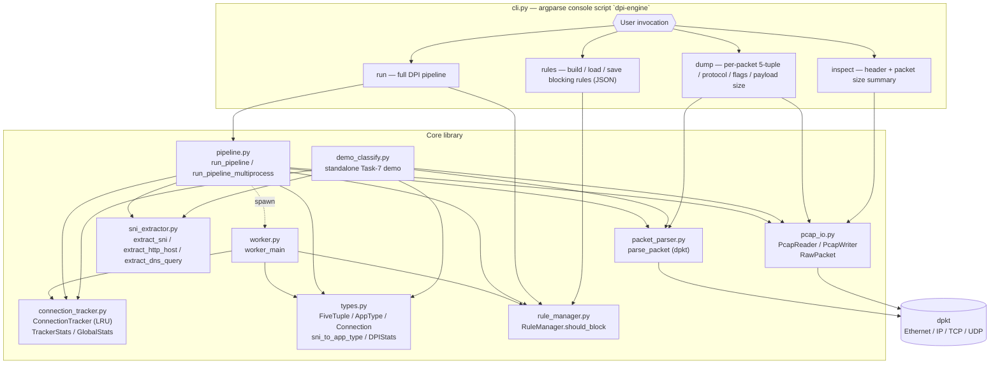

---

## 2. CLI command dispatch

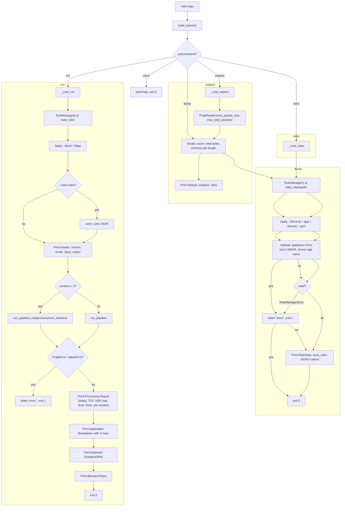

---

## 3. `PcapReader` / `PcapWriter` (pcap_io.py)

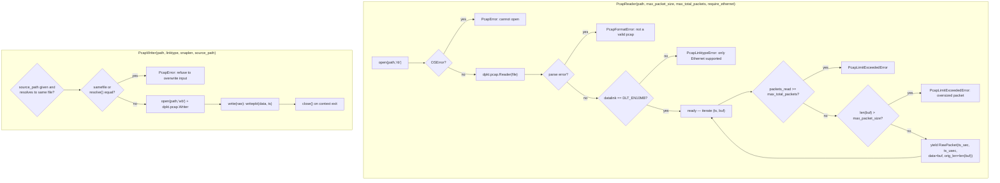

---

## 4. `parse_packet` (packet_parser.py)

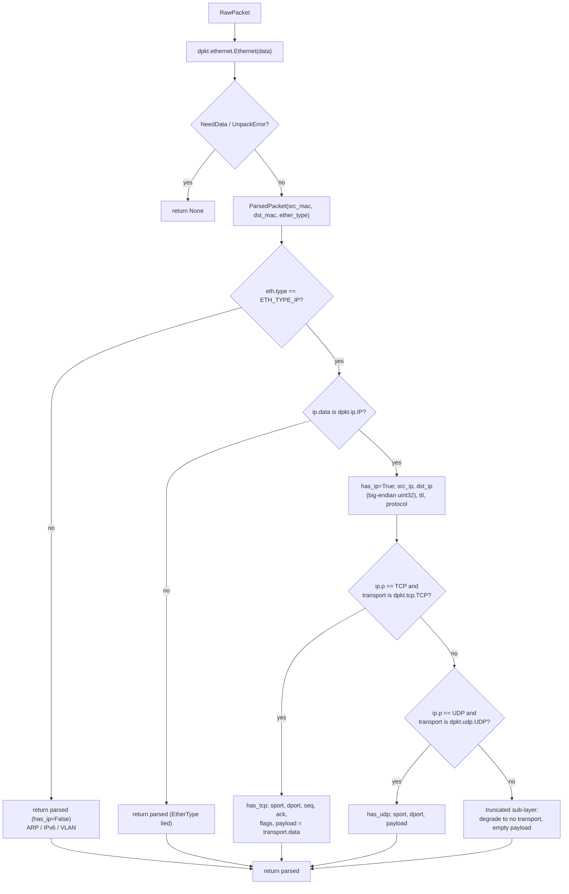

---

## 5. Classification logic — `classify_flow_from_packet` (pipeline.py:73)

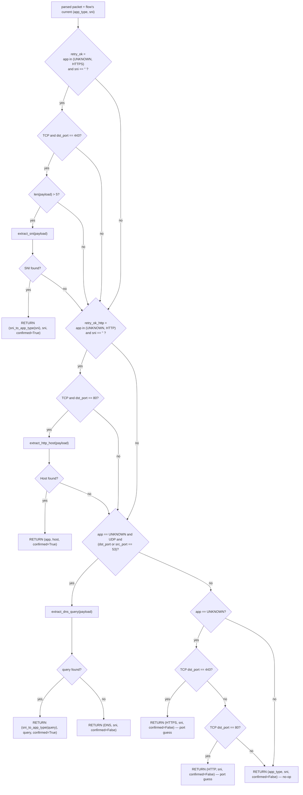

### `sni_to_app_type` domain → app mapping (types.py:179)

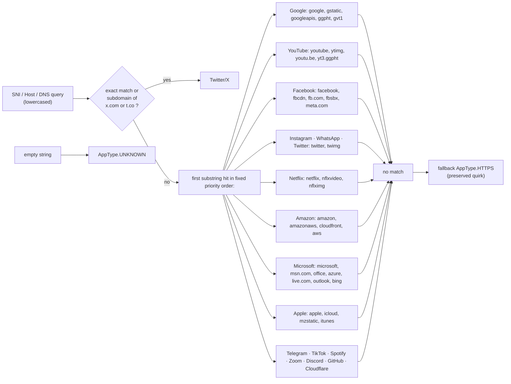

### Extractors (sni_extractor.py) — bounds-checked, never raise

```mermaid
flowchart TB
    subgraph TLS["extract_sni(payload) — every skip bounds-checked first"]
        T0{"is_tls_client_hello?<br/>len >= 9, type 0x16,<br/>version 0x0300-0x0304,<br/>rec_len fits, hs type 0x01"}
        T0 -- no --> TN["None"]
        T0 -- yes --> T1["skip 5B record hdr<br/>check +4B handshake hdr"]
        T1 --> T2["check +2B version +32B random"]
        T2 --> T3["session_id_len byte,<br/>check +len"]
        T3 --> T4["cipher_suites_len u16,<br/>check +len"]
        T4 --> T5["compression_len byte,<br/>check +len"]
        T5 --> T6["extensions_len u16,<br/>clamp extensions_end to length"]
        T6 --> T7{"walk extensions<br/>while offset+4 <= end"}
        T7 --> T8{"type == 0x0000 (SNI)?"}
        T8 -- no --> T9["offset += ext_len, continue"]
        T8 -- yes --> T10{"ext_len >= 5, list_len >= 3,<br/>sni_type == 0x00,<br/>sni_len <= ext_len-5 ?"}
        T10 -- no --> TN
        T10 -- yes --> T11["decode ascii, else latin-1"]
        T9 --> T7
        T11 --> TOK["SNI string (confirmed)"]
    end

    subgraph HTTP["extract_http_host(payload)"]
        H0{"is_http_request?<br/>first 4B in GET /POST / PUT / HEAD / DELE / PATC / OPTI"} -- no --> HN["None"]
        H0 -- yes --> H1["scan for case-insensitive 'Host:'"]
        H1 --> H2["skip spaces/tabs, read to CR/LF"]
        H2 --> H3{"value non-empty?"}
        H3 -- yes --> H4["strip ':port' suffix, decode ascii"]
        H3 -- no --> H1
        H4 --> HOK["Host string (confirmed)"]
    end

    subgraph DNS["extract_dns_query(payload)"]
        D0{"is_dns_query?<br/>len >= 12, QR bit clear,<br/>qdcount != 0"} -- no --> DN["None"]
        D0 -- yes --> D1["walk labels from offset 12"]
        D1 --> D2{"label_len == 0?"} -- yes --> D3{"labels?"}
        D2 -- no --> D4{"label_len > 63?<br/>(compression ptr / invalid)"} -- yes --> D3
        D4 -- no --> D5{"offset+label_len <= length?"} -- no --> D3
        D5 -- yes --> D6["append label, advance"] --> D1
        D3 -- yes --> D7["join labels with '.'"]
        D3 -- no --> DN
        D7 --> DOK["queried domain (confirmed)"]
    end
```

---

## 6. Connection / flow state machine (connection_tracker.py + types.py)

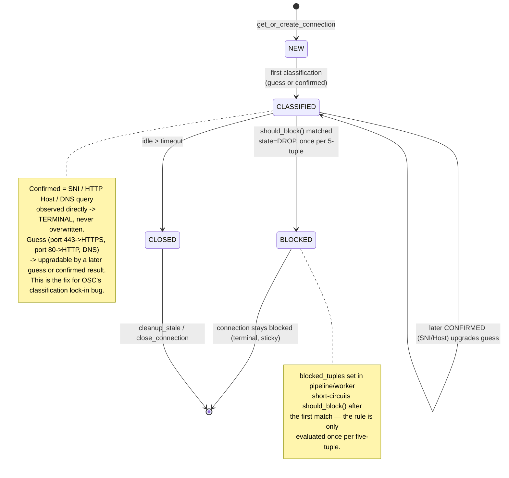

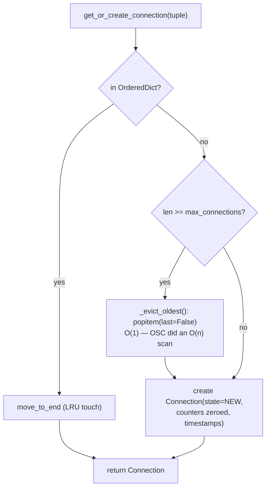

---

## 7. Rule evaluation (rule_manager.py)

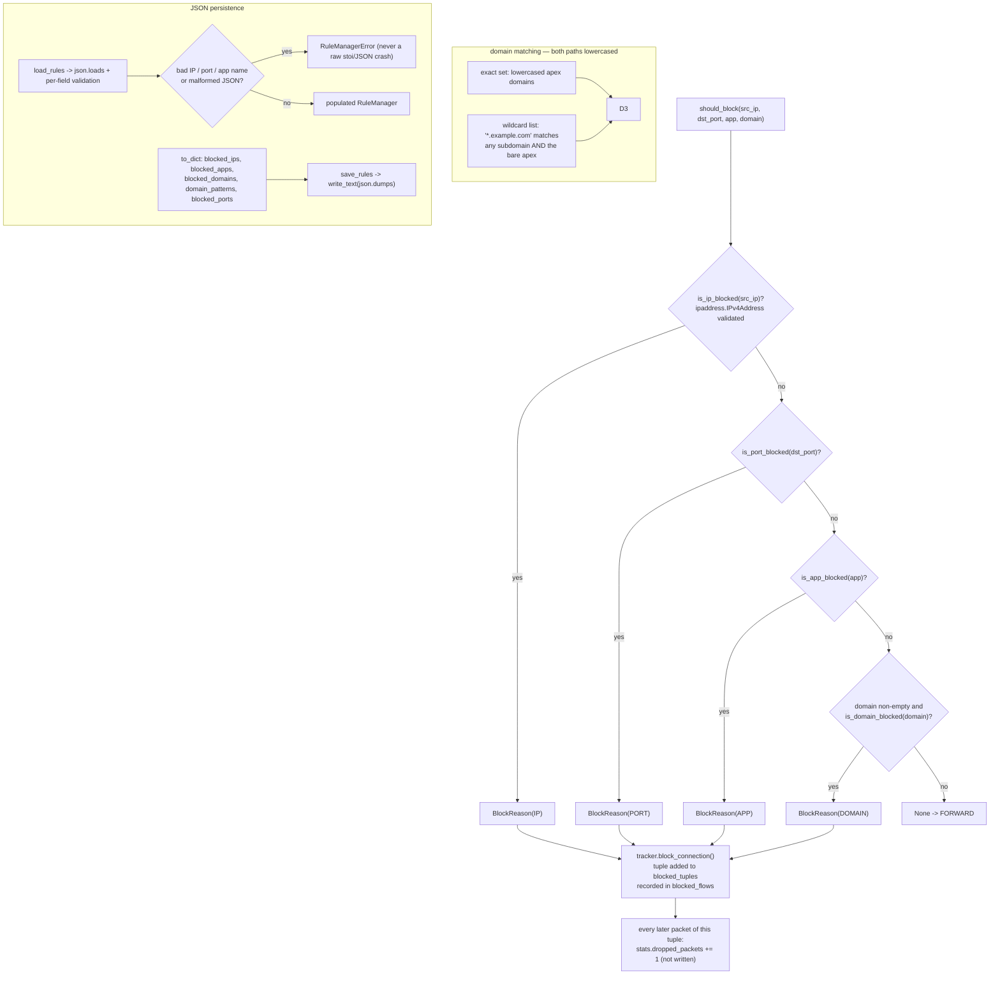

---

## 8. Single-process pipeline — `run_pipeline` (pipeline.py:119)

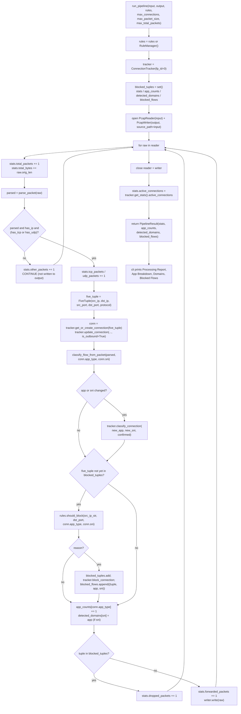

---

## 9. Hash-partitioned multiprocess pipeline — `run_pipeline_multiprocess` (pipeline.py:219)

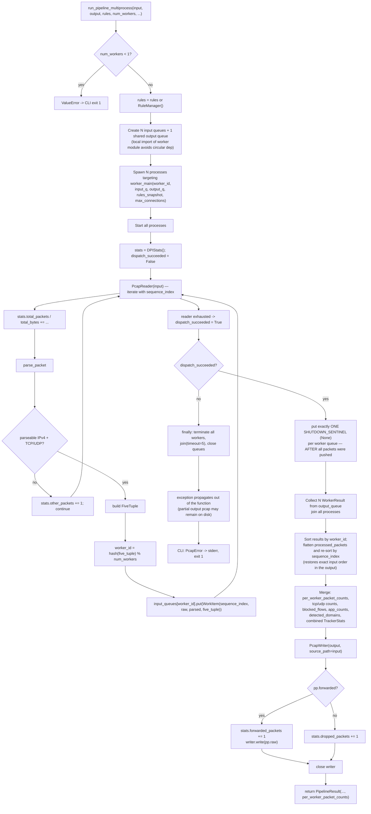

### Worker process loop (worker.py:119)

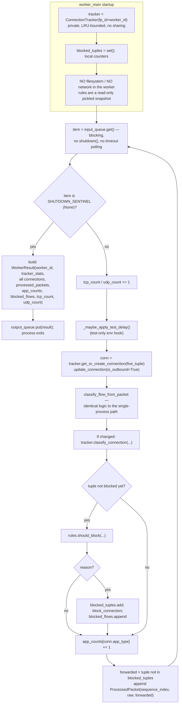

### Why hash-partitioning + the drain protocol

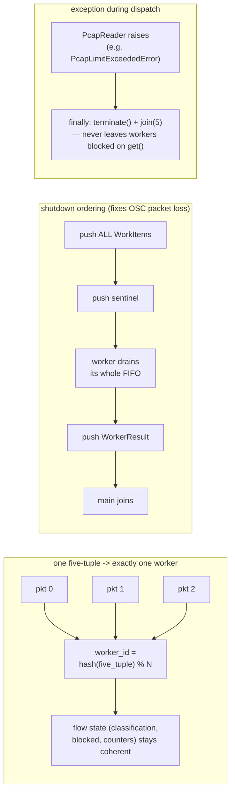

---

## 10. `demo_classify.py` — standalone classification demo

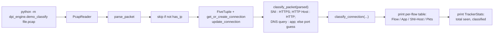

---

## 11. End-to-end data flow summary

```mermaid
flowchart LR
    subgraph MAIN["Main process (only place that touches the filesystem)"]
        direction TB
        M1["Input .pcap"] --> M2["PcapReader<br/>(bounds-checked)"]
        M2 --> M3["parse_packet<br/>(dpkt Ethernet/IP/TCP/UDP)"]
        M3 --> M4{"single-process<br/>or hash-partitioned?"}
        M4 -- single --> M5["in-process classify + should_block"]
        M4 -- "--workers N" --> M6["hash(5-tuple) % N -> input queue"]
        M6 --> M7["collect WorkerResults,<br/>re-sort by sequence_index"]
        M5 --> M8["merge stats + write Output .pcap"]
        M7 --> M8
    end

    subgraph W["Worker process 0..N-1 (pure compute)"]
        direction TB
        W1["WorkItem in FIFO"] --> W2["private ConnectionTracker"]
        W2 --> W3["extract_sni / extract_http_host /<br/>extract_dns_query -> AppType"]
        W3 --> W4["RuleManager.should_block<br/>(immutable snapshot)"]
        W4 --> W5["ProcessedPacket(outcome)"]
        W5 --> W6["WorkerResult on sentinel"]
    end

    M6 -.mp.Queue.-> W1
    W6 -.mp.Queue.-> M7

    M8 --> M9["Filtered output .pcap<br/>(blocked flows removed)"]
    M8 --> M10["CLI report:<br/>Processing / App Breakdown /<br/>Domains / Blocked Flows"]
```

### Safety envelope (enforced at every untrusted boundary)

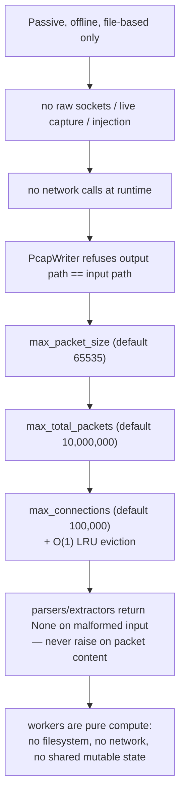
